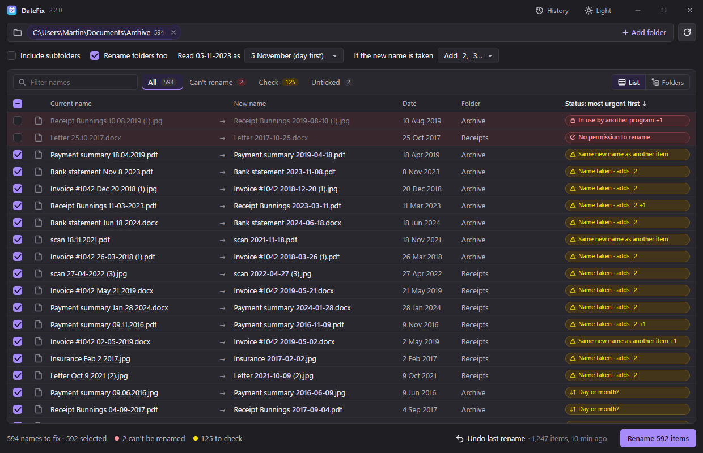

#  DateFix

[](https://github.com/Psybernet/DateFix/actions/workflows/tests.yml)
[](https://github.com/Psybernet/DateFix/releases/latest)
[](https://tauri.app/)
[](https://www.rust-lang.org/)

Messy dates in file names make files hard to sort. DateFix finds the date in each file or folder name and rewrites it as **YYYY-MM-DD**, so everything lines up in date order.



| Before | After |
|---|---|
| `11 November 2022 notes.txt` | `2022-11-11 notes.txt` |
| `Report Nov 22 2022.pdf` | `Report 2022-11-22.pdf` |
| `scan 05.11.2023.jpg` | `scan 2023-11-05.jpg` |
| `IMG_20231105_123456.jpg` | `IMG_2023-11-05_123456.jpg` |

## Download

Get **`DateFix-vX.Y.Z-setup.exe`** from the [latest release](https://github.com/Psybernet/DateFix/releases/latest) and run it, or use **`DateFix-vX.Y.Z-portable.exe`** to run it without installing. It works on Windows 10 and 11.

Everything DateFix saves, such as your undo history, goes in a **`DateFix data`** folder next to the program, never in hidden folders elsewhere. Uninstalling removes it too. For the portable version, just delete the `.exe` and its `DateFix data` folder.

The installer isn't code-signed, so Windows may say it's from an unknown publisher. Click **More info → Run anyway**.

## How to use it

1. **Drop a folder** onto the window, or click the drop area to browse (<kbd>Ctrl</kbd>+<kbd>O</kbd>).
2. **Check the preview.** The old date is shown in red and the new one in green. Untick anything you want to leave alone.
3. Click **Rename**.

Changed your mind? **Undo last rename** puts every name back, even after you've closed and reopened the app (<kbd>Ctrl</kbd>+<kbd>Z</kbd>). The undo history is kept in the `DateFix data` folder next to the program.

**Options**
- **Include subfolders** also fixes names inside folders within the folder.
- **US date order** reads `05-11-2023` as 11 May instead of 5 November.
- **If the new name is taken**, DateFix either adds a number (`2023-06-05_2.txt`) or skips that item. It never overwrites a file.

## Dates it recognises

| Style | Examples |
|---|---|
| Numbers, year first | `2023-11-05`, `2023_11_05`, `2023.11.05` |
| Numbers, day first | `05-11-2023`, `5.11.2023` (or month first with US date order) |
| Day, month, year | `11 November 2022`, `3rd July 2021`, `11Nov23` |
| Month, day, year | `November 11 2022`, `Nov 22, 2022`, `Sept 3 2021` |
| Compact | `20231105` (years 1900–2099) |

Only the first date in a name is changed. Anything that isn't a real date, like `31-02-2023` or `invoice 12345678`, is left alone.

## Command line

The release also includes **`datefix-cli.exe`**, which does the same from a terminal:

```text
datefix [OPTIONS] [FOLDER]

  -r, --recursive    Also fix names inside subfolders
  -m, --month-first  Read 05-11-2023 as 11 May (US style)
  -n, --dry-run      Only show what would change
  -y, --yes          Don't ask; add _2, _3… when a name is taken
      --undo         Put back the names changed by the last rename
```

Run it without a folder and it asks for one, shows the changes and asks before renaming.

## How it's built

```text
crates/datefix-core   Rust library: finds dates, plans and applies renames, undo journal
crates/datefix-cli    Command-line tool built on the core
src-tauri             Desktop app: Tauri 2 backend, Windows Mica/Acrylic glass effect
ui                    The interface: HTML, CSS and JavaScript, no framework
```

The app and the command-line tool share one core library, so they always understand the same dates.

**Automation (GitHub Actions)**
- **[Tests](.github/workflows/tests.yml)** run on every push, on Windows and Linux: formatting, unit and file-system tests, Clippy lints, and a Windows build check of the desktop app.
- **[Release](.github/workflows/release.yml)** runs when a version tag is pushed. It checks that the tag matches the version in the code, runs the tests, builds the installer, MSI and command-line tool, and publishes them on the Releases page.

## Developing

You need [Rust](https://rustup.rs/), [Node.js](https://nodejs.org/) (only for the Tauri command-line tool) and, on Windows, the WebView2 runtime, which Windows 10 and 11 already include.

```bash
cargo test -p datefix-core -p datefix-cli   # run the tests
npx @tauri-apps/cli@2 dev                   # run the app with live reload
cargo run -p datefix-cli -- "D:\Scans" -n   # try the command-line tool
```

Open `ui/index.html` in a browser to work on the interface with demo data.

See [CHANGELOG.md](CHANGELOG.md) for what changed in each version.

**Releasing:** set the new version in `Cargo.toml` and `src-tauri/tauri.conf.json`, commit, then `git tag v2.1.0` and `git push origin v2.1.0`.

## License

[MIT](LICENSE) © 2024–2026 Martin Heine
